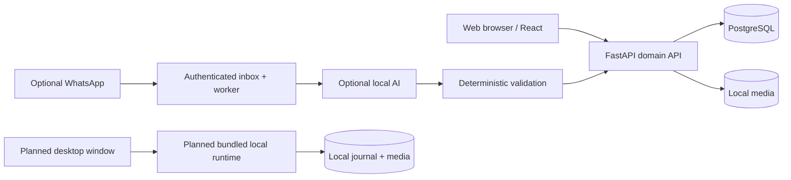

# Pelagium — Engineering & Security Showcase

> A personal reading journal with a web experience, a conversational roadmap and an offline-first desktop distribution track.

**Status (28 October 2026):** active development · private commercial application · public engineering case study · **no public desktop installer or production SaaS release yet**.

**Pelagium** is the current product name; *NautilusBook* remains the historical repository name. This repository does **not** contain the private product implementation or an installable application.

## Product vision

Pelagium helps readers organize books, notes, reading progress, rereads, statistics, covers and a customizable journal. Two complementary ways to use the product are being developed:

| Experience | Goal | Current boundary |
|---|---|---|
| Online web application | Access a personal journal in a browser, with account-level isolation | Web application implemented and exercised in local tests; public beta deployment and security gates pending |
| Offline desktop application | Download, install and use the journal on a personal Windows computer, without a domain, VPS, Docker or command-line setup | **Design and feasibility assessment (DESKTOP-1)**; no standalone installer has been released |

WhatsApp and natural-language assistance are additional integration tracks. They are **not prerequisites** for the core offline reading journal.

## What has been demonstrated

During private development, isolated local laboratories have tested encrypted backup/restore, media preservation, reproducible source transfer, local Docker image transfer and an offline journal recovery. The **OFFLINE-4c3** local integrity and persistence checks were reported as completed on 28 October 2026. A four-image import was also confirmed on a second physical Windows computer; a complete end-user, Docker-free installer **has not** been demonstrated.

These are **private laboratory results**, not claims of a general-public release, independent security certification or deployment readiness. Historical test counts elsewhere in the documentation refer to specific earlier snapshots, not an all-time global test total.

## Architectural boundaries

The web system already has an application API and persistent journal. The desktop branch is **proposed architecture**, not shipped code. Backend packaging and the embedded database choice are being assessed; the existing PostgreSQL laboratory stack must not be mistaken for a user-facing installer.

Natural-language model output is never the authority for a database mutation: structured interpretation is normalized and validated by domain rules. Optional messaging/AI services must not prevent local core functions from starting.

## Security and continuity

Engineering controls covered in private development include authentication and session revocation, per-user authorization, webhook HMAC checks, durable idempotent inbox processing, media validation, encrypted backups, integrity manifests, recovery rehearsals and production-oriented network hardening.

Before inviting external testers, the online service still needs actual HTTPS/DNS/SMTP, completed legal documentation, a secured host, off-host encrypted backups, restore drills and multi-user security testing. A desktop release additionally needs code-signing assessment, verified offline dependencies, a one-click installer, automatic local runtime lifecycle, update/rollback safety, data migration and a clean-Windows installation test.

The intended user experience is **download → install → open → read**, with no requirement to manage Docker or PostgreSQL.

## Engineering material

- [Current status and milestones](docs/project-status.md)
- [Desktop distribution roadmap](docs/desktop-roadmap.md)
- [Architecture](docs/architecture.md)
- [Self-hosted and offline boundaries](docs/self-hosted-deployment.md)
- [Threat model](docs/threat-model.md)
- [Security decisions](docs/security-decisions.md)
- [Engineering lessons](docs/engineering-lessons.md)
- [Public disclosure boundary](docs/public-disclosure-boundary.md)

## Disclosure and licensing

This is a **documentation/portfolio repository**, not an open-source release of the commercial product. Source code, private prompts, credentials, user data, database dumps, restore keys and deployment values are intentionally excluded. See [NOTICE](NOTICE.md).

AI-assisted development has been used for implementation and documentation. Human-directed requirements, tests and real-environment validation remain separate from generated suggestions.

## Português — resumo

O **Pelagium** é um diário de leitura com biblioteca, notas, progresso, releituras, estatísticas e journal personalizável. O núcleo web já foi desenvolvido e testado em ambiente local. A distribuição **desktop sem Docker, servidor ou domínio** está em fase de arquitetura (DESKTOP-1): **ainda não existe um instalador público pronto**.

O showcase divulga decisões de engenharia, segurança e aprendizados sem expor o código-fonte comercial, dados de leitores ou segredos. O beta online e a distribuição desktop possuem homologações próprias e ainda não foram liberados publicamente.
