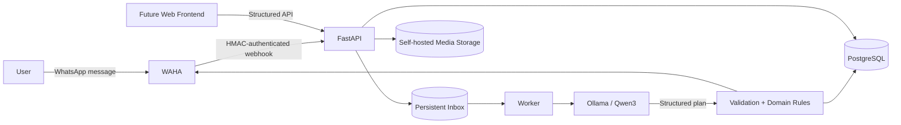

# NautilusBook — Engineering & Security Showcase

> A security-conscious, self-hosted book journal that can be updated through natural-language conversations on WhatsApp using a local LLM.

**Status:** active development · private commercial product · public engineering case study

This repository is **not** the NautilusBook product source code. It is a public showcase of the architecture, security decisions, threat model, engineering lessons, and validation strategy behind the project.

The private product is being developed as a potential SaaS. The purpose of this repository is to document the engineering work without publishing the commercial core.

## Why NautilusBook exists

The original idea was simple: keep a personal reading journal and update it naturally through WhatsApp.

A user should be able to write things such as:

- “I started reading Dune today.”
- “I’m on page 120.”
- “I finished it. Rating: 5/5.”
- “What did I write about Dune?”

Turning that into a reliable system quickly became more than an LLM integration. The project had to deal with webhook authenticity, retries, idempotency, identity resolution, conversational ambiguity, asynchronous processing, authorization, session revocation, file-upload security, data lifecycle, backups, and deployment hardening.

That evolution is the main subject of this repository.

## Architecture at a glance

The LLM is **not** treated as an authority. Natural-language output is converted into a structured plan, normalized, validated, and only then passed to domain services.

## Security-oriented design

Selected controls implemented during development include:

- HMAC-authenticated WhatsApp webhooks;
- idempotent webhook processing and persistent inbox state;
- asynchronous worker instead of long-running webhook execution;
- chat-level leases to avoid concurrent processing of the same conversation;
- separation of WhatsApp LID identity from phone numbers;
- structured LLM outputs with deterministic post-validation;
- explicit ambiguity handling instead of silently changing the wrong book;
- access tokens + rotating refresh tokens + revocable sessions;
- refresh-token replay detection;
- Argon2 password hashing and rehash support;
- login/token request throttling;
- per-user authorization boundaries;
- image validation, re-encoding and metadata removal;
- self-hosted media storage abstraction;
- account export and deletion workflows;
- data-retention jobs;
- backup verification and restore tooling;
- non-root application containers;
- local-only administrative ports in development;
- production profile with reverse proxy, HTTPS, request limits and internal-only services.

See [Threat Model](docs/threat-model.md) and [Security Decisions](docs/security-decisions.md).

## What was learned by breaking it

Several important controls exist because tests exposed real failure modes during development:

| Failure observed | Engineering response |
|---|---|
| Duplicate WAHA webhook configuration caused repeated deliveries | Removed duplicate source, preserved idempotent processing |
| WhatsApp `@lid` was initially treated like a phone number | Split messaging identity from resolved phone identity |
| Retries could duplicate journal writes | Persisted external message identity + idempotency |
| The LLM sometimes applied an update to the previously active book | Explicit-title precedence + deterministic catalog resolution |
| One message could describe changes to two books | Replaced single intent with a multi-operation structured plan |
| Bursts of messages produced fragmented replies | Persistent queue + debounce + deferred consolidated response |
| `want_to_read` could coexist with actual progress | Domain invariants enforced in service, API and database |
| A configuration value serialized with the wrong JSON type caused Ollama HTTP 400 responses | Typed normalization + regression test |

More detail: [Engineering Lessons](docs/engineering-lessons.md).

## Validation snapshot

At the milestone represented by this showcase:

- **76 automated tests** passed in the development stack;
- the real Ollama multi-book/partial-title probe completed **5/5 scenarios**;
- database migrations were validated against PostgreSQL;
- pre-migration integrity checks and a verified backup were executed before domain-changing migrations;
- data-integrity checks passed after migration;
- a production-oriented hardening profile exists, but public production deployment is **not claimed as complete**.

This repository intentionally avoids claims such as “production-ready” or “100% secure”. The remaining operational work is documented in [Project Status](docs/project-status.md).

## Technology stack

| Area | Technology |
|---|---|
| API | Python, FastAPI, Pydantic |
| Persistence | PostgreSQL, SQLAlchemy, Alembic |
| Local LLM | Ollama + Qwen3 |
| Messaging | WhatsApp via WAHA |
| Async processing | PostgreSQL-backed inbox + worker |
| Authentication | JWT access tokens, rotating refresh tokens, revocable sessions |
| Password hashing | Argon2 |
| Media | Validated/re-encoded WebP stored on self-hosted filesystem abstraction |
| Containers | Docker Compose |
| Reverse proxy / TLS profile | Caddy |
| Testing | Pytest + integration probes |

## Documentation map

- [Architecture](docs/architecture.md)
- [Threat Model](docs/threat-model.md)
- [Security Decisions](docs/security-decisions.md)
- [Security Testing Strategy](docs/security-testing.md)
- [Engineering Lessons](docs/engineering-lessons.md)
- [AI-Assisted Development](docs/ai-assisted-development.md)
- [Privacy & Data Lifecycle](docs/privacy-data-lifecycle.md)
- [Self-Hosted Deployment Model](docs/self-hosted-deployment.md)
- [Project Status & Roadmap](docs/project-status.md)
- [Public Disclosure Boundary](docs/public-disclosure-boundary.md)
- [GitHub Publication Checklist](docs/github-publication-checklist.md)
- [Screenshot Guide](docs/screenshot-guide.md)

## AI-assisted development disclosure

NautilusBook has been developed with extensive AI assistance for implementation, architecture review, debugging, test generation, and documentation.

Product direction, requirements, acceptance criteria, real-environment testing, security decisions, bug reproduction, and final validation are human-directed. Generated code and suggestions are treated as untrusted until tested and reviewed.

See [AI-Assisted Development](docs/ai-assisted-development.md).

## Repository scope and licensing

This is a **portfolio/documentation repository**, not an open-source release of the NautilusBook commercial product.

The private application source, production configuration, credentials, user data, prompts, database dumps, WhatsApp sessions and deployment secrets are intentionally excluded.

No open-source license for the private NautilusBook product is granted by this repository. See [NOTICE.md](NOTICE.md).

## Português — resumo

O NautilusBook é um book journal self-hosted em desenvolvimento, com integração via WhatsApp e IA local. Este repositório público documenta arquitetura, threat modeling, decisões de AppSec, testes e aprendizados do projeto, mas **não contém o código-fonte comercial do SaaS**.

A proposta do showcase é demonstrar processo de engenharia e segurança sem abrir o core do produto.
