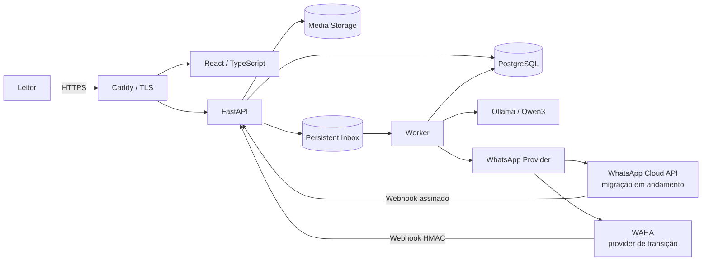

# Pelagium — Engineering & Security Showcase

> Um diário pessoal de leitura com frontend web, journal personalizável, autenticação, operações de privacidade e integração conversacional por WhatsApp.

**Status:** desenvolvimento ativo · produto privado · beta fechado em preparação · showcase público de engenharia

Este repositório **não contém o código-fonte privado do Pelagium**. Ele documenta arquitetura, decisões de segurança, threat modeling, estratégia de testes, aprendizados e evolução operacional do projeto.

O produto começou como **NautilusBook** e foi rebatizado como **Pelagium** durante a preparação para o beta privado. O slug deste repositório ainda preserva o nome histórico.

## O que é o Pelagium

Pelagium é um diário de leitura pessoal. A interface web permite:

- organizar livros e releituras;
- acompanhar progresso;
- escrever resenhas, notas e citações;
- avaliar leituras;
- personalizar o journal;
- manter histórico de sessões;
- gerenciar conta, segurança, exportação e exclusão.

O WhatsApp funciona como canal de captura conversacional. A integração original usa WAHA em desenvolvimento e está sendo migrada para a **WhatsApp Business Platform / Cloud API oficial**.

## Arquitetura atual

O domínio não depende do transporte de WhatsApp escolhido. O worker publica por uma interface de provider, permitindo coexistência temporária entre WAHA e Cloud API durante a migração.

## Estado de validação

### Baseline estável — v0.15.5

O último baseline mergeado e validado antes da migração oficial do WhatsApp inclui:

- **234 testes backend**;
- frontend com `structure-check`, TypeScript typecheck e build de produção;
- **14 testes operacionais**;
- pilot gate;
- production structure gate;
- Alembic head validado;
- smoke manual de journal, autenticação e recuperação de senha.

### v0.16 — em andamento

A linha v0.16 adiciona:

- abstração de provider para WhatsApp;
- provider WAHA preservado como transição;
- sender para Cloud API oficial;
- webhook oficial com challenge verification;
- validação `X-Hub-Signature-256` via HMAC-SHA256;
- deduplicação reaproveitando a inbox existente;
- configuração provider-aware;
- testes de entrada/saída da Cloud API.

A migração ainda **não é apresentada como concluída em produção**. App Meta, callback HTTPS real, credenciais permanentes e número definitivo fazem parte da próxima etapa operacional.

## Controles de segurança implementados

Entre os controles presentes no produto privado:

- access token + refresh token rotativo;
- sessões revogáveis;
- detecção de reutilização de refresh token;
- Argon2 para senhas;
- rate limiting e lockout persistente;
- política de senha centralizada;
- confirmação/verificação de e-mail;
- recuperação de senha com token temporário de uso único;
- autorização por ownership;
- testes de IDOR horizontal;
- optimistic concurrency;
- proteção CSRF/origin;
- headers de segurança;
- request-size limits;
- upload de imagem validado e reprocessado;
- HMAC em webhooks;
- inbox persistente e deduplicação;
- logs estruturados;
- backups verificados e restore drill;
- offsite backup;
- retenção de dados;
- workflow de solicitações de privacidade;
- incident response de privacidade;
- containers com `no-new-privileges`, `cap_drop` e filesystem read-only onde aplicável;
- production deployment gate.

Veja [Threat Model](docs/threat-model.md), [Security Decisions](docs/security-decisions.md) e [Security Testing](docs/security-testing.md).

## Privacidade e operação

O projeto inclui fluxos para:

- exportação de dados;
- exclusão de conta;
- retenção configurável;
- privacy requests;
- registro e tratamento de incidentes;
- backup local + offsite;
- restore drill;
- monitoramento externo;
- host preflight;
- deployment gate de produção.

Esses controles não substituem revisão jurídica ou de segurança externa antes de uma escala comercial maior.

## IA no produto

O Pelagium atualmente usa Ollama/Qwen3 para interpretação conversacional local. O modelo **não é autoridade de domínio**: saídas passam por normalização, resolução e regras determinísticas antes de qualquer mutação persistente.

A arquitetura está sendo preparada para reduzir dependência do LLM em operações simples. A direção planejada é **deterministic-first / AI-on-demand**: ações previsíveis devem funcionar sem inferência; IA fica reservada para interpretação ambígua e experiências de companion de leitura.

## Stack

| Área | Tecnologia |
|---|---|
| Frontend | React, TypeScript, Vite |
| API | Python, FastAPI, Pydantic |
| Persistência | PostgreSQL, SQLAlchemy, Alembic |
| Processamento assíncrono | Inbox persistente + worker |
| IA local | Ollama + Qwen3 |
| WhatsApp | WAHA em transição → Meta Cloud API |
| Autenticação | JWT + refresh rotation + sessões revogáveis |
| Password hashing | Argon2 |
| Containers | Docker Compose |
| Edge/TLS | Caddy |
| Testes | Pytest, unittest, integration/smoke gates |

## Documentação

- [Architecture](docs/architecture.md)
- [Project Status](docs/project-status.md)
- [Threat Model](docs/threat-model.md)
- [Security Decisions](docs/security-decisions.md)
- [Security Testing](docs/security-testing.md)
- [Engineering Lessons](docs/engineering-lessons.md)
- [AI-Assisted Development](docs/ai-assisted-development.md)
- [Privacy & Data Lifecycle](docs/privacy-data-lifecycle.md)
- [Self-Hosted Deployment](docs/self-hosted-deployment.md)
- [Public Disclosure Boundary](docs/public-disclosure-boundary.md)
- [Screenshot Guide](docs/screenshot-guide.md)

## Desenvolvimento assistido por IA

Pelagium é desenvolvido com uso intensivo de IA para implementação, refactoring, debugging, revisão arquitetural e documentação.

Conceito de produto, requisitos, critérios de aceite, execução dos testes reais, reprodução de bugs, decisões de risco e aprovação final permanecem conduzidos pelo responsável pelo projeto.

Código e sugestões gerados são tratados como implementação não confiável até sobreviverem aos gates e testes.

Veja [AI-Assisted Development](docs/ai-assisted-development.md).

## Escopo público

Este repositório é um **case study/portfolio**, não uma distribuição open source do produto.

Código privado, prompts internos, migrations completas, credenciais, dados de usuários, backups, configurações de produção e segredos continuam fora do repositório público.

Veja [NOTICE.md](NOTICE.md).
