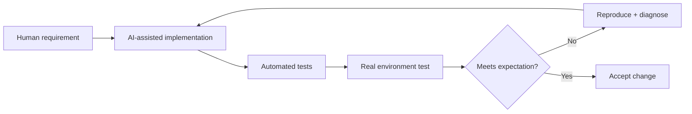

# AI-Assisted Development

Pelagium is developed with extensive AI assistance. This is documented intentionally rather than hidden.

## What AI assistance has been used for

- code generation and refactoring;
- architecture alternatives;
- test-case generation;
- debugging hypotheses;
- documentation drafting;
- migration and deployment review;
- security-control brainstorming.

## What remains human-directed

- product concept and priorities;
- UX expectations;
- commercial direction;
- acceptance criteria;
- which trade-offs are acceptable;
- running the software in the real environment;
- reproducing bugs;
- deciding whether a fix actually solves the observed problem;
- security posture and disclosure decisions;
- final approval of changes.

## Why disclose this

Using AI does not make generated implementation automatically correct. Pelagium repeatedly demonstrated the opposite: outputs that looked plausible sometimes failed because of identity semantics, API payload typing, model ambiguity, retry behavior or real infrastructure configuration.

The development process therefore treats AI output as **untrusted implementation assistance**.

A simplified workflow is:

## Portfolio statement

A concise and accurate way to describe the work is:

> Pelagium is a personal product project designed, specified and validated by me, developed iteratively with AI assistance for implementation, architecture review and debugging.

This communicates both tool usage and engineering ownership without implying that every line was manually typed or that the product was autonomously created by an AI system.
