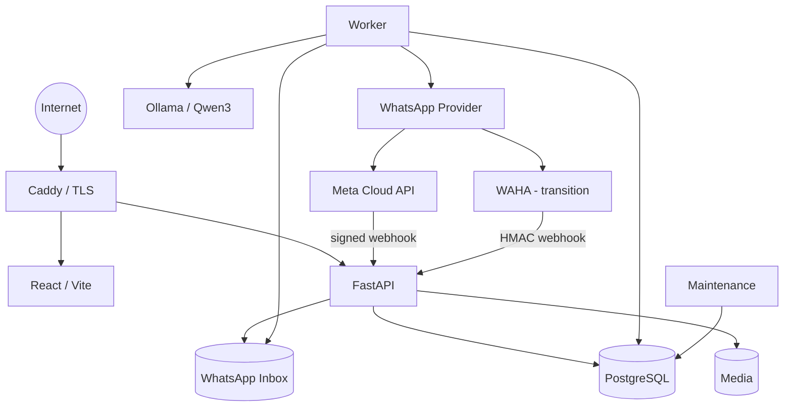
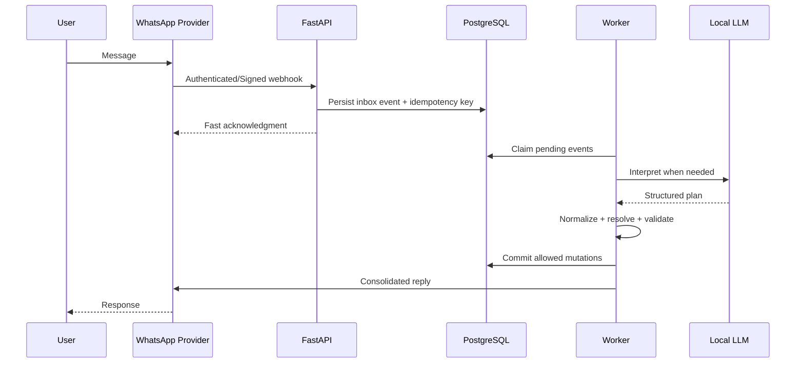
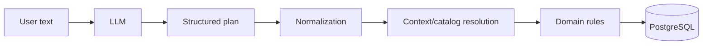

# Architecture

## Design goals

Pelagium is organized around six goals:

1. **Personal reading memory** — the journal is the product core.
2. **Deterministic persistence** — probabilistic components do not bypass domain rules.
3. **Failure tolerance** — retries, duplicate events and slow inference must not corrupt state.
4. **User isolation** — ownership is enforced at the application boundary.
5. **Operational recoverability** — backups must be restorable, not merely created.
6. **Provider independence** — transport integrations should not leak into domain logic.

## Runtime topology

Only the edge should be internet-accessible in production. PostgreSQL, Ollama, API internals and administrative services remain private to the host/container network.

## Web application

The web frontend is no longer a future milestone. It currently includes:

- authentication;
- library;
- journal detail;
- progress/status/rating;
- reread history;
- cover management;
- journal customization;
- notes, reviews and quotes;
- statistics;
- WhatsApp linking/status;
- account/security/privacy actions.

The frontend performs deterministic operations through structured API calls. It does not need an LLM for ordinary journal interactions.

## WhatsApp lifecycle

WAHA and Meta Cloud API are adapters around the same internal message lifecycle.

## LLM boundary

The LLM is an interpreter, not a database agent.

Authorization, ownership, progress invariants, concurrency and catalog decisions remain deterministic.

## Authentication boundary

Browser authentication uses:

- short-lived access token;
- rotating refresh token;
- HttpOnly refresh cookie;
- persisted/revocable sessions;
- replay detection;
- password-change session invalidation.

Password reset and e-mail verification use expiring single-use tokens.

## Privacy and operational boundary

The production-oriented architecture includes:

- verified backup manifests;
- restore drills;
- offsite copies;
- external health monitoring;
- host preflight;
- production safety checks;
- retention jobs;
- privacy-request history;
- incident-response records.

## Deliberately omitted publicly

The showcase does not expose:

- private application source;
- production prompts;
- complete migrations/schema;
- real infrastructure values;
- credentials/tokens;
- user data;
- backups;
- commercial roadmap details that are not necessary to explain the engineering.
