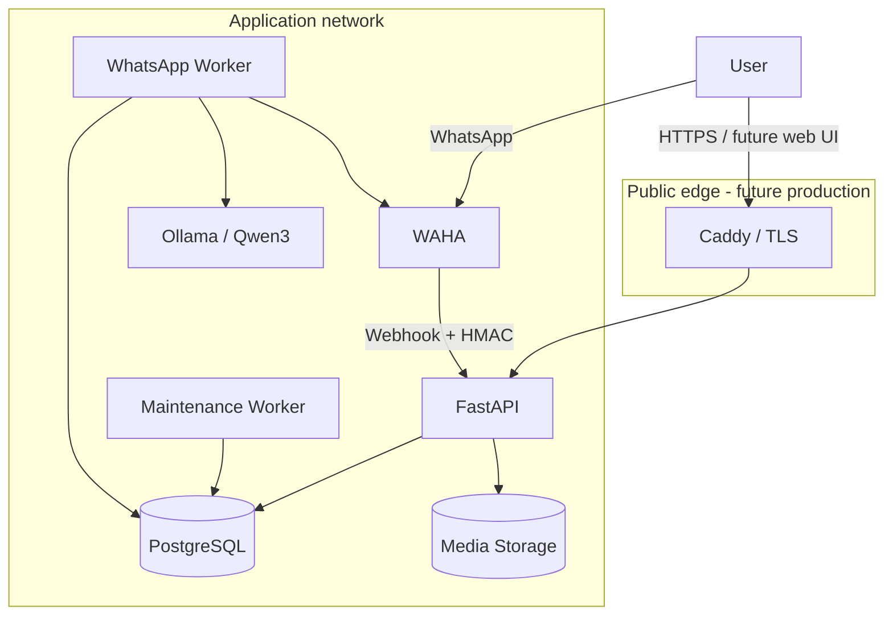
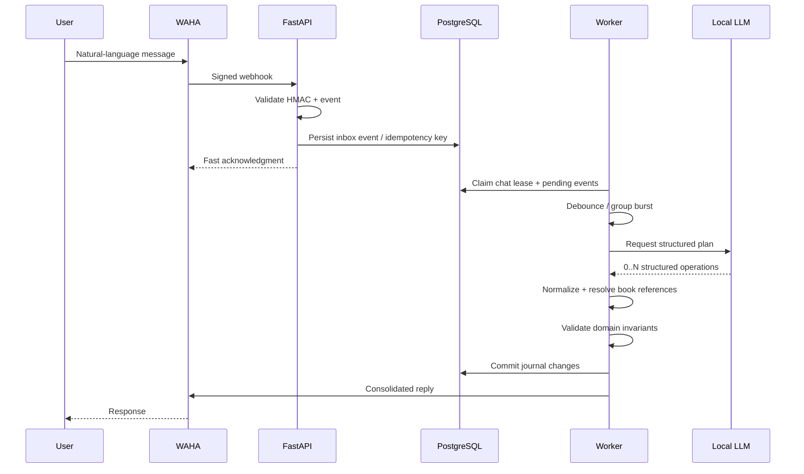
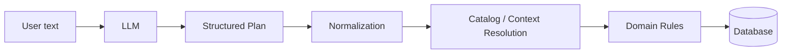
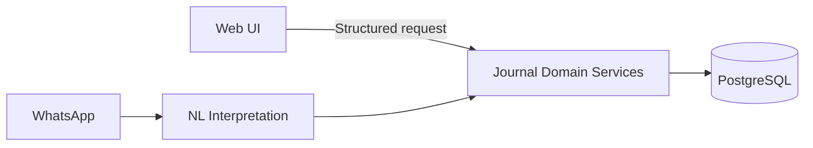

# Architecture

## Design goals

NautilusBook was designed around five goals:

1. **Natural interaction** — users can update a journal through conversational language.
2. **Deterministic persistence** — an LLM may interpret language, but it must not directly control database writes.
3. **Failure tolerance** — webhook retries, model latency and duplicate events must not corrupt user state.
4. **User isolation** — one account must never be able to read or mutate another account’s journal.
5. **Self-hosted operation** — the system should not require cloud object storage or hosted LLM APIs.

## Runtime components

In local development, administrative ports are bound only to `127.0.0.1`. In the production-oriented profile, internal services are not exposed directly to the internet.

## WhatsApp message lifecycle

The webhook does not wait for model inference. This reduces coupling between WhatsApp retry behavior and LLM latency.

## LLM boundary

The LLM is treated as an interpreter, not as a database agent.

Examples of deterministic logic after the model:

- exact book matches take priority;
- partial titles are resolved against books already present in the user’s journal;
- ambiguous references are rejected instead of guessed;
- progress and status invariants are enforced independently of model output;
- multiple operations are supported in one message;
- a previously active title cannot silently override a title explicitly named by the user.

## Identity model

WhatsApp may identify a user through an opaque `@lid` rather than a phone number. NautilusBook therefore models messaging identity separately from resolved phone identity.

This prevents an opaque WhatsApp identifier from being incorrectly persisted or authorized as if it were a phone number.

## Web and WhatsApp share the same domain

The future web client will not “talk to the LLM” for deterministic operations.

This keeps business rules consistent regardless of client.

## Deliberately omitted from this public repository

The public showcase does not expose:

- private application source code;
- production prompts;
- complete database schema/migrations;
- internal deployment values;
- secrets, credentials or sessions;
- user data or backups;
- proprietary product roadmap details.
