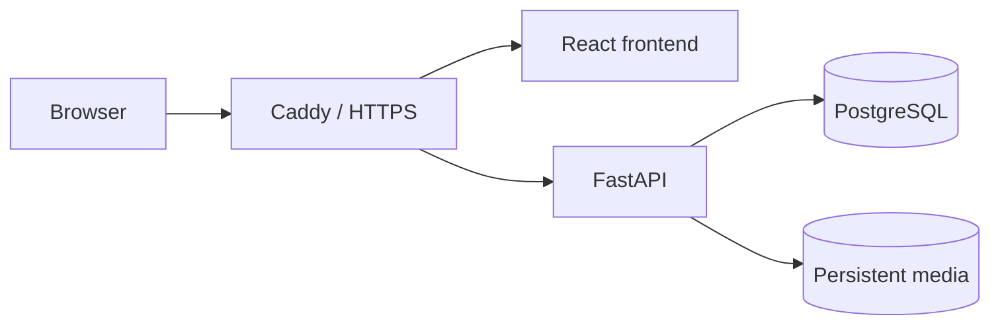
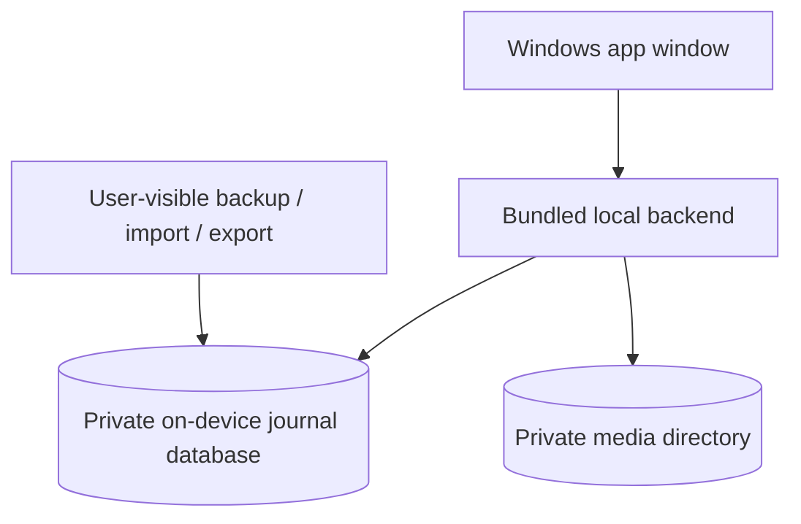

# Self-hosted and Offline Deployment Boundaries

Pelagium supports the goal of reader control over personal data. There are **two distinct deployment tracks**.

## Online web service (not publicly released)

The online topology requires secure host provisioning, DNS/TLS, private service networks, account isolation, SMTP verification, monitoring, off-host backups, restore drills and reviewed legal documentation. Optional WhatsApp and AI components may require additional infrastructure and should not block the core web journal after the corresponding configuration work is complete.

The existing production-oriented Compose profile is **not itself proof** of a live, secured VPS deployment.

## Technical offline laboratory — already exercised

Separate Windows Docker projects have been used to rehearse local journal functions, verified archives, encrypted recovery, OCI image transport and persistence checks. These steps demonstrate technical feasibility for a server-independent local journal but require Docker and administrative steps inappropriate for nontechnical readers.

They are not the proposed distribution path for the desktop product.

## Planned personal desktop product — not yet shipped

Requirements:

- One installer; no manual Docker, Python, PostgreSQL or server/domain setup.
- Core features available after disconnecting from the internet.
- Data and media persist across application restarts and updates; uninstall does not silently destroy the journal.
- Local backend is not exposed to the LAN or to other users of the computer.
- Export, import, backup and recovery are understandable to a reader.
- External search, AI and messaging may need internet but are not startup dependencies.
- Clean Windows installation and recovery tests are required before public distribution.

The desktop packaging format, local database choice and offline prerequisites are still being assessed in DESKTOP-1. Publishing a self-contained installer is a **future milestone**, not something already available from this showcase.

## Continuity

Encrypted backups need their decryption key. A lost legacy `age` identity cannot simply be replaced to decrypt the old archive. Where the original journal is still accessible, a fresh portable export may offer a separate migration route, subject to implementation and testing.

For further details see [Desktop distribution roadmap](desktop-roadmap.md) and [Project Status](project-status.md).
