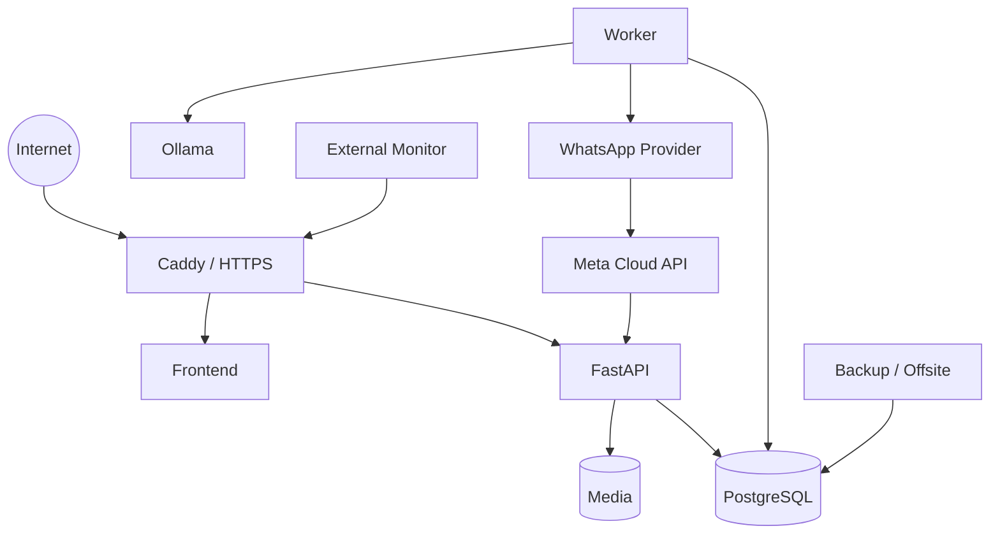

# Self-Hosted Deployment Model

Pelagium is designed to run on a single hardened VPS during the private-beta stage without requiring AWS/GCP or hosted object storage.

## Development

Local development uses Docker Compose with administrative ports bound to loopback where possible.

## Production-oriented topology

Internal services are not meant to be directly exposed to the internet.

## Current operational tooling

The private repository includes:

- Linux/host preflight;
- Docker/Compose validation;
- firewall/time-sync checks;
- external health monitoring;
- local backup verification;
- offsite backup synchronization;
- restore/recovery drill;
- production deployment gate;
- container hardening checks.

## WhatsApp migration

WAHA is retained temporarily for transition/testing. The target production channel is the official Meta WhatsApp Cloud API.

The production callback is expected to be served behind the same Caddy edge as the application.

## Email

Development can log e-mail delivery. Public beta requires a real SMTP transport for verification/reset links.

## Production claim boundary

The architecture and gates are prepared for real deployment, but this showcase does not claim that a production deployment is complete until:

- a real VPS is provisioned;
- DNS/TLS are verified;
- SMTP works externally;
- offsite backup and restore drill pass on the host;
- external monitoring is live;
- Cloud API webhook/send flow is validated end-to-end;
- the production gate passes against the real environment.
