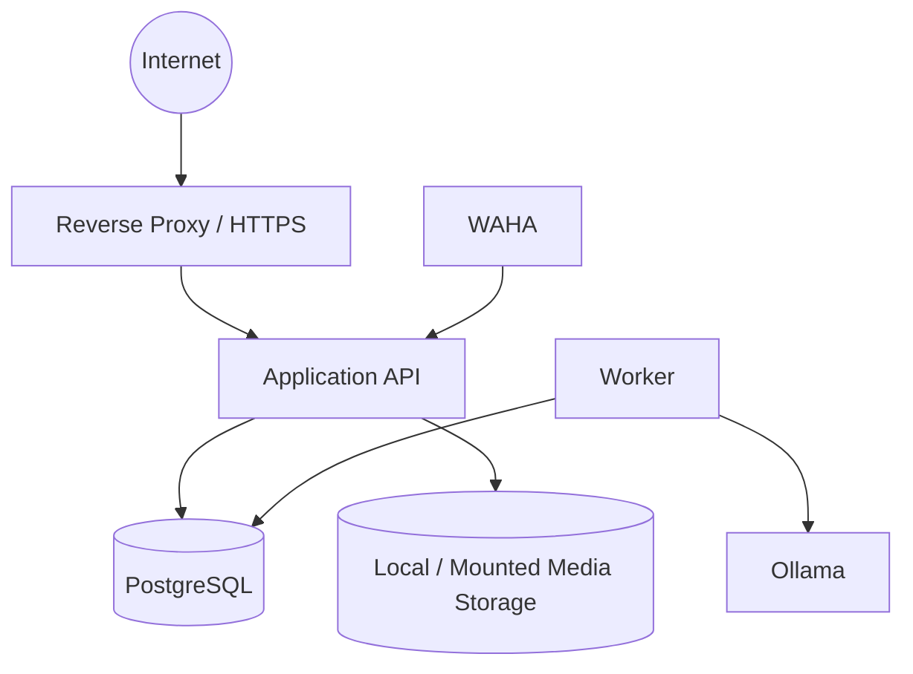

# Self-Hosted Deployment Model

NautilusBook is intentionally designed so that the product does not require AWS, GCloud or paid object storage.

This document describes the intended model at a high level. It is not a copy of the private production configuration.

## Development

The current development environment runs through Docker Compose on a local machine.

Administrative services are reachable only through loopback bindings (`127.0.0.1`) rather than all network interfaces.

## Future production topology

Only the public edge should be internet-accessible. Database, LLM and application-internal services remain private to the container/host network.

## Self-hosted media

Uploaded covers can live on storage owned by the operator, for example a mounted filesystem on a dedicated server.

Required operational controls include:

- filesystem permissions;
- storage usage monitoring;
- backups to a different disk/host;
- tested restore procedure;
- deletion integration with account lifecycle.

## Email

The backend is provider-neutral and can use standard SMTP.

Development does not require a real SMTP server. Public production does, because password-reset and verification links must not be emitted to logs.

Self-hosting mail is possible but introduces deliverability requirements such as SPF, DKIM, DMARC and reverse DNS. That is an operational decision, not an application dependency.

## Production is not claimed yet

The product has a production-oriented deployment profile and security preflight, but a real public deployment still requires:

- Linux host hardening;
- DNS and TLS validation;
- SMTP validation;
- firewall policy;
- external/off-host backup;
- restore drill;
- monitoring and alerting;
- dependency/container vulnerability review;
- application-security testing after the frontend exists.
