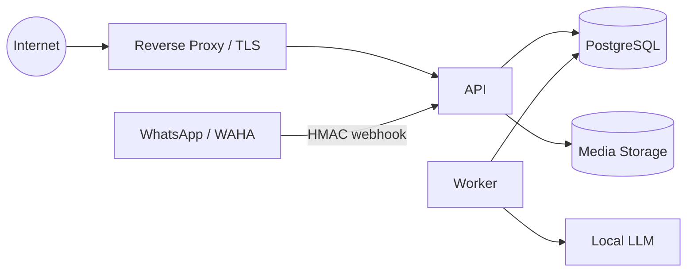

# Threat Model

This is a practical threat model for the current NautilusBook architecture. It is not a formal certification and will evolve with the frontend and production environment.

## Protected assets

Primary assets include:

- account credentials and authentication sessions;
- refresh tokens and password-reset/verification tokens;
- journal entries, reading history, ratings and notes;
- WhatsApp identity linkage;
- uploaded cover images;
- database backups;
- API/JWT/HMAC/WAHA secrets;
- private conversation context used to interpret journal actions.

## Trust boundaries

Main trust transitions:

1. external client → HTTP API;
2. WAHA → webhook endpoint;
3. webhook queue → asynchronous worker;
4. worker → local LLM;
5. application → database;
6. user upload → media processing pipeline;
7. privileged operator → backups / production host.

## Threats and controls

### 1. Webhook spoofing

**Threat:** an attacker submits forged WhatsApp events directly to the webhook.

**Controls:**

- HMAC verification over the webhook payload;
- independent WAHA API key;
- sender/account authorization after transport authentication;
- fail-closed validation before message processing.

### 2. Duplicate delivery / replay

**Threat:** retries or duplicate webhook configuration apply the same action more than once.

**Controls:**

- persistent external message identifier;
- idempotent processing;
- inbox state tracking;
- chat-level processing lease.

### 3. Cross-account authorization failure / IDOR

**Threat:** user A requests a reading, note, cover or account resource belonging to user B.

**Controls:**

- authenticated user context at API boundary;
- domain queries scoped to account ownership;
- future frontend security testing explicitly includes horizontal authorization cases.

**Residual work:** dedicated end-to-end IDOR test suite should accompany the frontend.

### 4. LLM misinterpretation

**Threat:** the model updates the wrong book, invents a field, or interprets an ambiguous reference as a destructive action.

**Controls:**

- structured outputs rather than free-form commands;
- bounded multi-operation plan;
- deterministic catalog resolution;
- explicit ambiguity handling;
- domain invariants independent of LLM output;
- regression tests created from failures observed in real conversations.

### 5. Prompt injection / instruction confusion

**Threat:** user text attempts to redirect the model away from journal interpretation or cause unauthorized behavior.

**Controls:**

- the LLM has no direct database credentials or arbitrary tool access;
- model output is constrained to a predefined schema;
- authorization and business rules are enforced outside the model;
- out-of-domain requests can map to a no-op/help response.

**Residual risk:** adversarial prompt testing should continue before public beta.

### 6. Session/token theft

**Threat:** stolen refresh token is replayed to maintain access.

**Controls:**

- short-lived access tokens;
- rotating refresh tokens;
- refresh-token replay detection;
- revocable persisted sessions;
- password changes invalidate sessions;
- HttpOnly/Secure cookie model for production browser clients.

### 7. Password attacks

**Threat:** credential stuffing or brute-force attempts.

**Controls:**

- Argon2 hashing;
- minimum password requirements for new/reset passwords;
- persistent login throttling/lockout logic;
- application-level rate limiting;
- timing equalization path for unknown accounts.

### 8. Malicious image uploads

**Threat:** executable content disguised as an image, decompression bombs, metadata leakage, oversized uploads or cross-user image mutation.

**Controls:**

- allowlisted formats;
- content decoding instead of trusting the extension;
- byte, dimension and pixel limits;
- server-side re-encoding to WebP;
- metadata removal;
- random storage names;
- user-specific cover ownership.

### 9. Data leakage through logs

**Threat:** secrets, passwords, tokens or private user content are persisted in operational logs.

**Controls:**

- request logging is metadata-oriented (request ID, path, status, duration);
- no intentional password/body logging;
- production reset/verification links must not use log-based email delivery;
- Docker log rotation.

### 10. Database inconsistency

**Threat:** different clients or older code paths create impossible reading states.

**Controls:**

- invariants enforced in service/API/database layers;
- migration-time repair of historical inconsistent records;
- post-migration data-integrity checker;
- Alembic migrations and preflight checks.

### 11. Secret disclosure

**Threat:** application secrets are committed to Git or exposed through public documentation.

**Controls:**

- real `.env` files excluded from Git;
- public repository contains documentation only;
- separate private product repository;
- independent random secrets;
- pre-publication secret review.

### 12. Host / container compromise

**Threat:** compromised application container gains unnecessary host or network privileges.

**Controls in the production-oriented profile:**

- non-root application user;
- read-only root filesystem where practical;
- dropped Linux capabilities;
- `no-new-privileges`;
- internal-only service exposure;
- reverse proxy as public edge;
- memory/PID limits;
- separate persistent volumes.

## Abuse cases planned for future testing

- horizontal IDOR across readings, notes, covers and account actions;
- refresh-token replay and concurrent rotation races;
- malicious/malformed image corpus;
- webhook replay at high volume;
- WhatsApp message bursts designed to break ordering;
- LLM prompt injection and context poisoning;
- multi-book ambiguity attacks;
- rate-limit bypass through proxy/header manipulation;
- backup/restore misuse and path traversal attempts;
- SSRF review when future external metadata/cover fetching is introduced.
